# Sittin-Kitten
The Sittin' Kitten is an automated litterbox designed using SolidWorks
This project was designed by Drew Lawton, Sean Kelley, and Ziyang Zhou

 
The Sittin’ Kitten 
  
Drew Lawton, Sean Kelley, and Ziyang Zhou 
 
 
## Design Alternatives: 

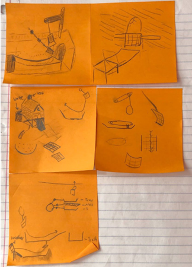
 
The first concept design involved using a simple pendulum swinging motion with a 
basket to remove the used litter. However, this design would be in the way and would require a 
ceiling to house the basket pendulum. This concept resulted in determining that the basket 
should be on a rail system along the edges of the assembly. 

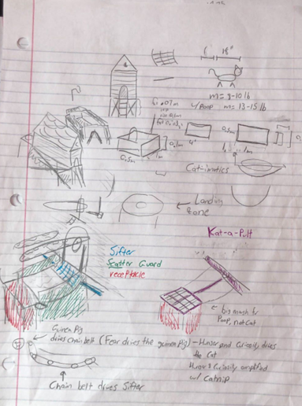
 
The second concept design utilized a cam along a chain or belt to move the basket up 
and down along a sloped recession in the tray. This created problems as to how the basket 
would elevate without taking up too much space. It was also troublesome to find a way for the 
cam to pull and push the basket up or down. The belt would also not have been able to translate 
the basket. This design led to the conclusion that simple translational motions would be easier 
to recreate with two crank slider mechanisms. 

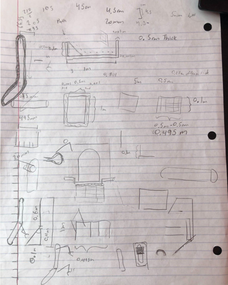

The third concept design involved two crank slider mechanisms transferring a basket to 
slide it along and then upwards the litter box. The major flaw with this design was figuring out 
how to transfer the basket with the sliders. The sliders would have to push and pull the basket at 
specific times as well as release the basket to transfer to the next slider. Thus we decided to 
replace the second slider with a basket that would deposit the litter separately. 
 
## Final Design Solution & Criteria and Design Decision: 

The final design solution involves a comb attached to a crank slider mechanism that 
would shift the litter where it is deposited into a basket. The basket will then rotate and deposit 
the litter into a trash receptacle. A lid was placed on the basket to prevent any potential 
projectiles from leaving the system. There is a motion sensor that will activate every other time it 
is tripped, that way only when the cat is leaving the litter box will it activate. 

Once the litter box is 
activated, the crank arm will complete one revolution, once the comb scoops the used litter onto the basket, the second motor will rotate 90 degrees counterclockwise then 90 degrees 
clockwise. Thus, the basket and comb are in position for the next time the litter box is activated. 
This addresses the project requirements by extracting used cat litter from the litter box 
and into a trash bin for easy removal. The assembly is relatively simple which makes it easy to 
disassemble for cleaning. The pieces that will be in contact with the litter are made of durable 
plastics to prevent rust and the spread of odors and bacteria. 
The product development process began with determining potential concept designs. 
The group knew they wanted a basket to have holes big enough to filter the finer litter but pick 
up the larger clumps of the used litter, that is why the comb design was used. The rails along 
the sides ensure an equal distribution of forces to the comb to minimize wear on the 
components. The slider crank mechanism was used to convert a rotational motion to the 
translational motion of the comb to isolate the used litter away from the rest of the litter. To 
remove the litter from the box itself, a basket was designed to provide a simple rotational motion 
to extract the used isolated litter into a trash bin. After the generalized idea was determined, 
basic dimensions were determined on the initial size of the litter box, metric units were used for 
ease of conversions and force analysis. The tray was built in SolidWorks with the basic 
dimensions and was altered to accommodate the parts to be added. A ramp is provided for the 
cat to walk up, the box is open to prevent mold and mildew from growing easily. The tray is also 
at an elevated height to accommodate the continuous rotation of the crank slider mechanism. 
To address any major shortcomings, more holes could be added to the comb for better 
sifting, or a hinged door on the back of the basket that could open when it reclines to further 
prevent spillage. Handles or holes could be inserted in the tray for easier transportation. 
Stippled gripping on the ramp for the cat could be added in future designs. The rails could have 
been lower to reduce the space used, or the basket could be shaped for optimum flow. 
Overall, The Sittin’ Kitten is an effective and convenient product that automatically 
removes cat litter for easy cleaning. It will keep your feline feeling fine and can be used for all 
nine lives!​™ 
 
## Design Constraints: 
When designing the Sittin’ Kitten, several constraints and assumptions were taken into 
consideration.  The product was made to have roughly the same footprint as an average litter 
box you would purchase from a pet store.  We estimated that the amount of litter would rise 2 
cm or 0.02 m.  The tray was 1 m long and 0.5 m wide, meaning we would have a volume of 0.01 
m^3.  With an assumed density of cat litter being 0.83 g/mL or 830 kg/m^3, the estimated mass 
of the litter contained would be 8.3 kg.  We also considered the weight of the product as a 
whole, so we chose materials that would be durable, but limit an excessive amount of weight. 
Considering the acidic nature of cat urine, we decided not to use any metal alloys that would 
come in contact with the litter.  We chose ABS plastic and PVC rigid for those parts that would 
come in contact with the litter. 
 
## Kinematics Analysis: 
The following work is an analysis of the crank slider mechanism used to operate the 
comb along the base of the litter box.  There are several figures drawn showing various 
positions of the mechanism.  The mechanism was designed around an electric DC motor that provides 0.006 hp. 
The motor has an adjustable speed, but we chose 6 rpm. We chose this 
because the time interval to complete a full cycle of the mechanism is 10 seconds.  

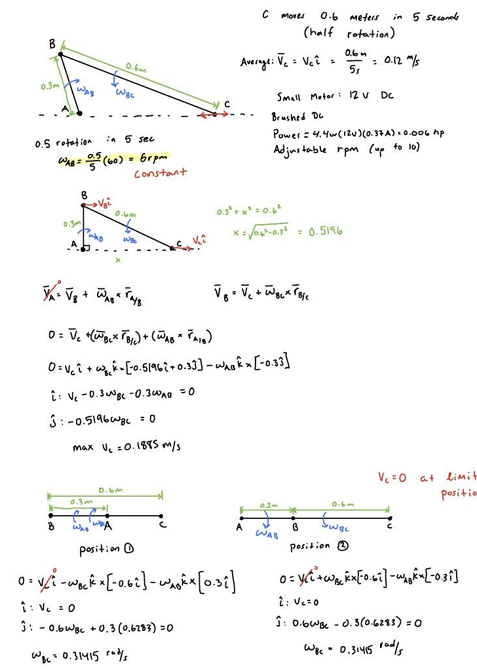
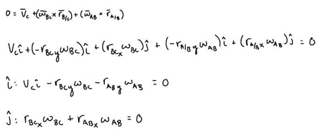

The above equations can be used to determine the values of the angular velocity of the 
connecting rod and the horizontal linear velocity of the slider.  To determine these values for a 
full cycle of the mechanism, we implemented a MATLAB code that outputs a matrix of values: 
distance between crank base and slider,  horizontal and vertical positions of the crank with 
respect to a given angle, angular velocity of the connecting rod, and slider velocity. 
The code also created a scaled animation with the axes being in meters.  The visualized 
angular velocity is slowed down  to make an easier viewing, but all of the values produced by 
the code itself are correct.  The video and code are included in separate documents. 

 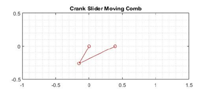
 
## Force Analysis: 
     For the force analysis, we decide to only focus on the rods and cranks. The reason is 
because there is not much motion related to the parts like the basket or trash can. The tool we 
used to do the force analysis was the SolidWorks FEA simulation tool which is a built- in tool in 
SolidWorks.  

For the Part Crank 1-A: 

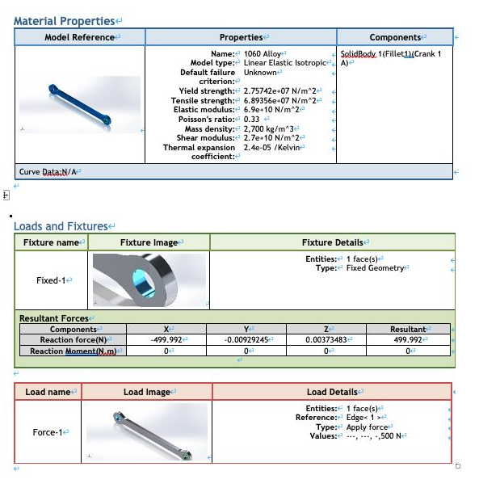
 
For the Part Crank 1-B: 

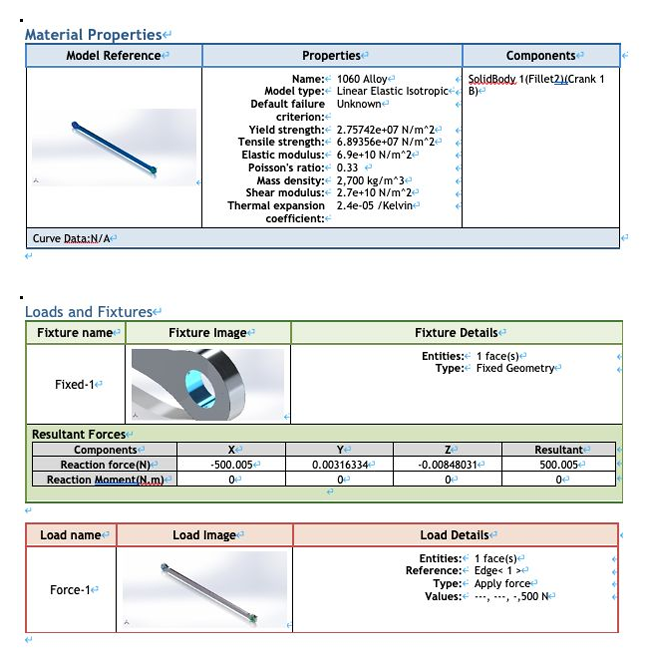
 
For the part Pin B:

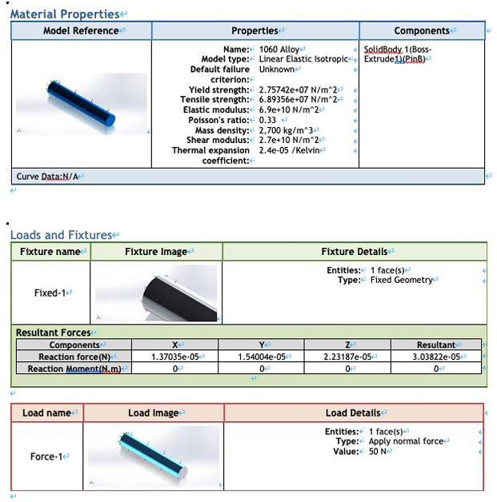

For the part Rod: 

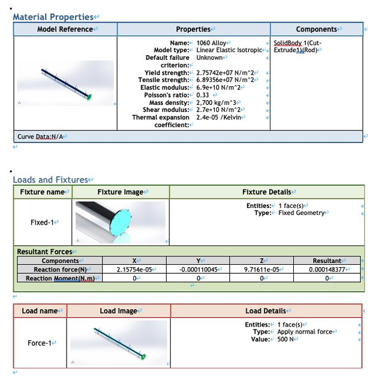
 
## Mechanics of Materials Analysis: 

When testing the materials, we applied forces well above what the system would usually 
encounter so that our results would be applicable for even the largest of cats.  We chose the 
motors we used based on this criteria from Jameco Electronics, “An application’s specifications 
such as voltage, current, torque, and velocity will determine which motor is most appropriate so 
be sure to pay attention to its requirements.”  Using this, we knew that we needed a motor that 
could produce a relatively low velocity in rotations per minute.  We also considered the power 
that each motor would consume and attempted to minimize the cost of electricity.  The motor we 
chose was able to produce up to 0.006 horsepower and a maximum torque of 0.7845 N-m. 
Additionally, we were satisfied with this torque output because there would be no other external forces on the crank or connecting rod besides its own weight.  Analyzing the crank arm, we 
found the maximum shear stress that would be created by this torque and compared it to the 
1060 alloy’s fatigue strength.  

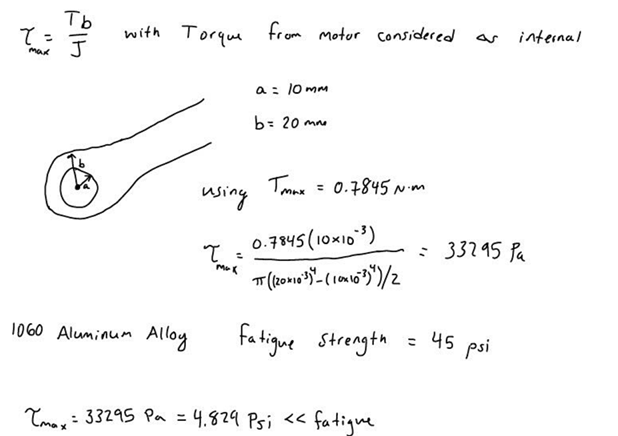

Using what we calculated above, we know that through regular use of the mechanism, 
the fatigue on the crank will never cause cracking and the rods will remain in their elastic states. 
 
## Design Drawings: 
Drew Lawton, Sean Kelley, and Ziyang Zhou 
 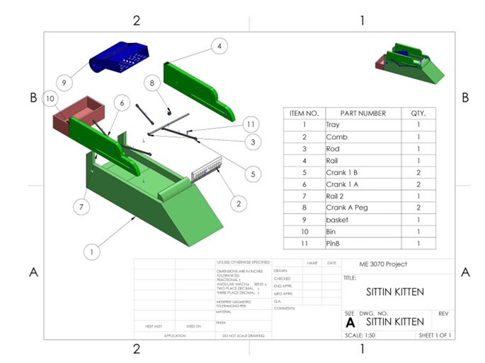
 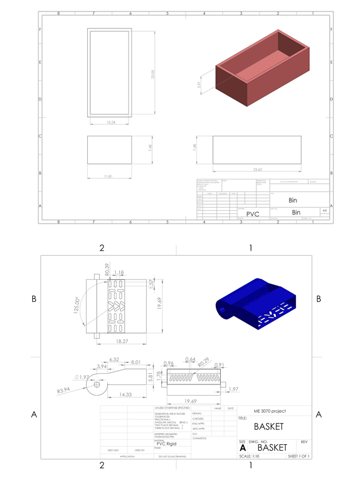
 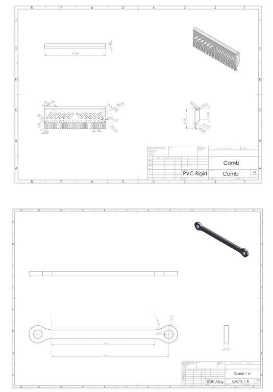
 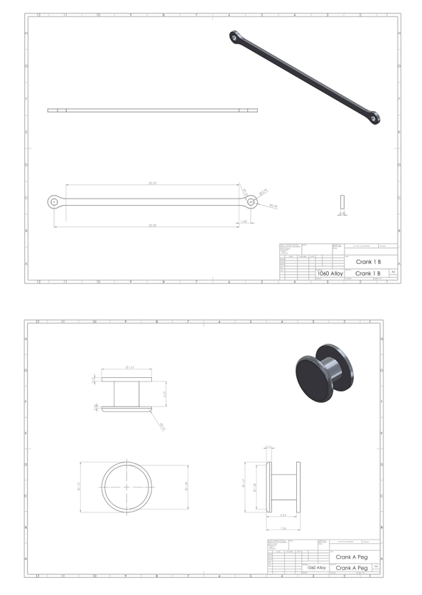
 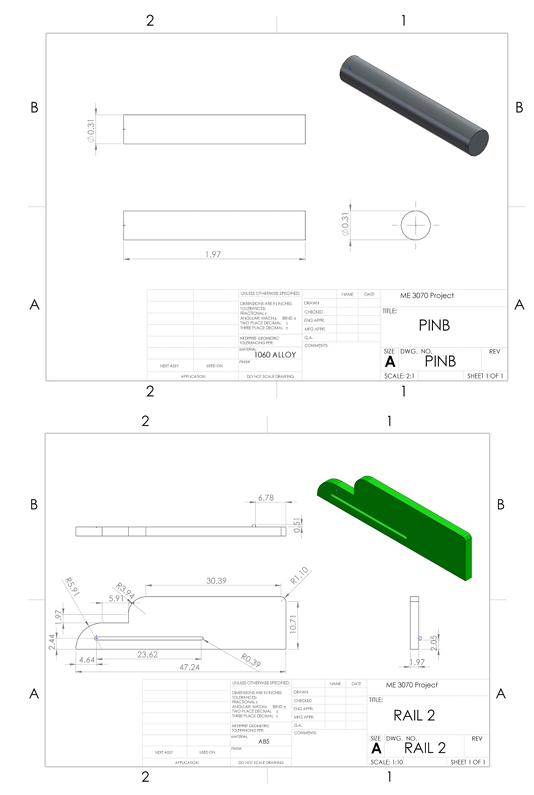
 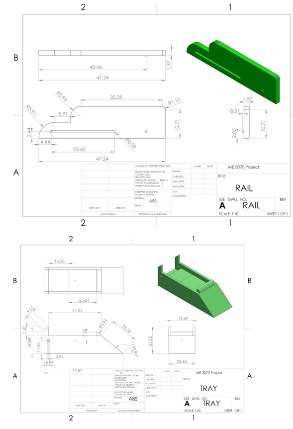
 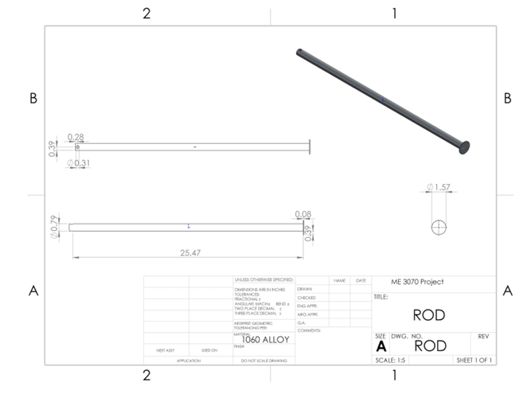
 
How to Choose a Motor: 
https://www.jameco.com/Jameco/workshop/ProductNews/motor-buyers-guide.html#:~:text=Con
sider%20an%20application's%20purpose%20and,pay%20attention%20to%20its%20requireme
nts​.  
Drew Lawton, Sean Kelley, and Ziyang Zhou 
